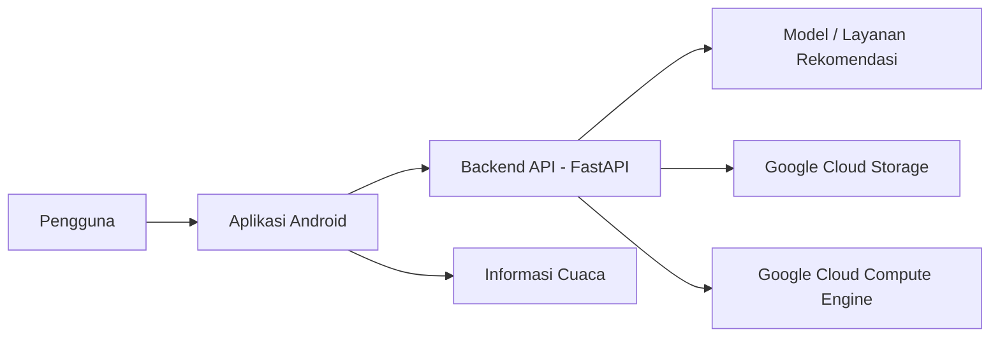

# Clozify — Fashion Recommendation Based on Mood & Weather

Clozify adalah proyek capstone **Bangkit Academy 2024** berupa aplikasi rekomendasi fashion yang membantu pengguna menemukan inspirasi outfit berdasarkan suasana hati (*mood*) dan kondisi cuaca. Proyek ini menggabungkan pemrosesan machine learning, aplikasi Android, serta layanan cloud untuk mendukung alur rekomendasi.

## Ringkasan Proyek

- **Nama proyek:** Clozify
- **Program:** Bangkit Academy 2024 Capstone Project
- **Tim:** C242-PS413
- **Fokus:** Rekomendasi outfit berdasarkan mood dan cuaca
- **Platform:** Aplikasi Android dengan dukungan layanan cloud dan machine learning

## Struktur Repository

Repository portofolio ini menggabungkan dokumentasi dan salinan source code dari beberapa bagian proyek tim:

```text
Capstone-Bangkit-Clozify-Fashion-Recommendation/
├── backend/          # API FastAPI dan integrasi layanan cloud
├── machine-learning/ # Notebook dan berkas pendukung machine learning
├── mobile/           # Source code aplikasi Android
└── README.md         # Ringkasan proyek dan kontribusi
```

Dokumentasi tiap bagian:
- [Backend — instalasi dan konfigurasi](backend/README.md)
- [Machine Learning — isi dan batasan salinan](machine-learning/README.md)
- [Mobile — source code dan status aset](mobile/README.md)

**Catatan kelengkapan:** beberapa berkas biner belum tersedia pada salinan portofolio ini, termasuk sebagian aset gambar Android, Gradle Wrapper JAR, model machine learning, dan dataset tertentu. Oleh karena itu, repository ini belum diverifikasi sebagai salinan yang dapat langsung menjalankan seluruh komponen. Lihat README masing-masing folder untuk detail. Gunakan repository tim asli untuk memperoleh aset lengkap.

## Latar Belakang

Memilih outfit sehari-hari dapat dipengaruhi oleh banyak hal, termasuk suasana hati, kondisi cuaca, dan preferensi gaya. Clozify dikembangkan untuk memberikan rekomendasi outfit yang lebih kontekstual dengan memanfaatkan analisis ekspresi wajah untuk memperkirakan mood pengguna serta informasi cuaca terkini.

## Fitur Utama

- **Mood detection:** Menganalisis ekspresi wajah untuk mengidentifikasi kategori mood.
- **Weather information:** Memanfaatkan informasi cuaca sebagai konteks rekomendasi.
- **Fashion recommendation:** Memberikan rekomendasi outfit yang relevan dengan mood dan kondisi cuaca.
- **Mobile experience:** Menghadirkan alur penggunaan melalui aplikasi Android.

## Kontribusi Saya — Cloud Computing

Dalam proyek ini, saya berperan sebagai anggota **Cloud Computing**. Fokus pekerjaan saya berkaitan dengan dukungan infrastruktur dan layanan backend agar komponen aplikasi dapat berkomunikasi dengan layanan yang dibutuhkan.

Area kontribusi yang saya kerjakan:
- Menyiapkan dan menggunakan **Google Cloud Compute Engine** untuk mendukung layanan backend.
- Menggunakan **Google Cloud Storage** sebagai bagian dari kebutuhan penyimpanan cloud.
- Mendukung penyediaan endpoint backend menggunakan **FastAPI** agar layanan dapat diakses oleh komponen aplikasi.
- Berkolaborasi dengan anggota tim Machine Learning dan Mobile Development dalam integrasi komponen proyek.

*Deskripsi kontribusi ini dibatasi pada area Cloud Computing yang saya kerjakan. Implementasi model machine learning dan aplikasi Android merupakan bagian dari pekerjaan anggota tim sesuai perannya masing-masing.*

## Gambaran Arsitektur



Diagram di atas merupakan gambaran konseptual alur sistem, bukan diagram deployment lengkap dari seluruh konfigurasi produksi.

## Teknologi

| Area | Teknologi / Layanan |
|---|---|
| Cloud & Backend | Google Cloud Compute Engine, Google Cloud Storage, FastAPI |
| Machine Learning | TensorFlow, Pandas, ResNet50 embeddings, cosine similarity |
| Mobile Development | Android, Kotlin, Retrofit, CameraX, MVVM |
| Data | FER2013, Fashion Product Images Dataset |
| Project | Bangkit Academy 2024, tim C242-PS413 |

Teknologi di atas merupakan teknologi yang digunakan dalam proyek tim; tidak semuanya dikerjakan secara langsung oleh saya.

## Alur Kerja Singkat

1. Pengguna berinteraksi dengan aplikasi Clozify.
2. Aplikasi memanfaatkan masukan yang diperlukan untuk memperkirakan mood pengguna dan memperoleh konteks cuaca.
3. Komponen rekomendasi memproses konteks tersebut untuk membantu memilih outfit yang sesuai.
4. Layanan backend dan cloud mendukung komunikasi serta kebutuhan penyimpanan sistem.
5. Hasil rekomendasi ditampilkan melalui aplikasi Android.

## Tim Proyek

| Nama | Peran | Institusi |
|---|---|---|
| Raihan Putra Savana | Machine Learning | Universitas Negeri Malang |
| Farren Lyrananda Rachman | Machine Learning | Universitas Mulawarman |
| Andhika Sidiq Firmansyah | Machine Learning | Universitas Islam Bandung |
| **Sela Putri Ismalia** | **Cloud Computing** | **Universitas Mulawarman** |
| Wahyu Benartdo Sembiring | Cloud Computing | Universitas Pendidikan Nasional |
| Siti Nikmatul Ula | Mobile Development | Universitas Mulawarman |
| Nabila Putri Normalita | Mobile Development | Universitas Mulawarman |

---

**Proyek tim asli:** [C242-PS413 / Clozify-ML](https://github.com/C242-PS413/Clozify-ML)  
**Backend:** [C242-PS413 / clozify-backend](https://github.com/C242-PS413/clozify-backend)  
**Mobile:** [C242-PS413 / Clozify-MD](https://github.com/C242-PS413/Clozify-MD)  
**Dokumentasi portofolio:** Sela Putri Ismalia — Cloud Computing
